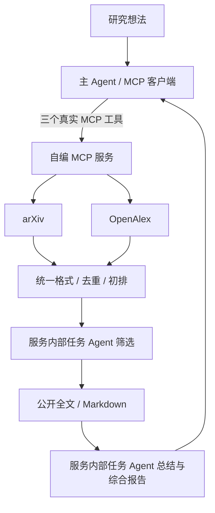

# 多源论文检索与总结 Agent

10 人课程小组项目的可运行开发框架。普通电脑即可启动默认演示，**不要求 24GB 显存、CUDA 或本地大模型**。

当前提供真实 MCP stdio 客户端/服务端、统一数据结构、两源检索适配器、去重与初排、服务内部任务 Agent 接口、全文处理、报告产出和并发实验入口。

**请区分两种模式：**

| 模式 | MCP 通信 | 论文与正文 | 筛选和总结 | 用途 |
|---|---|---|---|---|
| `demo`（默认） | 真实客户端与服务端进程 | 明确标记的合成样例 | 规则筛选、模板总结，无模型请求 | 各模块联调、验证通信与产物保存 |
| `live` | 真实 MCP | arXiv + OpenAlex；公开全文 | 主 Agent 模型工具调用；服务内部模型筛选、总结 | 接入自己的模型配置后完成真实验收 |

demo 跑通不代表真实论文检索、模型效果或优化收益已验证。当前源码是开发起点；组员的后续任务见[分工看板](docs/分工看板.md)。

## 快速运行

需要 Python 3.11+。本机首次验收使用 Windows / Python 3.13.2。项目固定 MCP SDK **1.30.0**；不要复制 v2 的 `MCPServer` / `Client` 示例进来，升级由组长统一处理。

Windows PowerShell，在项目目录执行：

```powershell
python -m venv .venv
.\.venv\Scripts\python.exe -m pip install -r requirements-dev.lock
.\.venv\Scripts\python.exe -m pip install --no-deps -e .
.\.venv\Scripts\python.exe -X utf8 -m paper_agent.cli --mode demo
```

也可以执行 `scripts/setup.ps1` 完成环境安装。无需激活虚拟环境，直接使用上面的解释器路径即可。

macOS / Linux：

```bash
python3 -m venv .venv
.venv/bin/python -m pip install -r requirements-dev.lock
.venv/bin/python -m pip install --no-deps -e .
.venv/bin/python -m paper_agent.cli --mode demo
```

测试和静态检查：

```powershell
.\.venv\Scripts\python.exe -m pytest -q
.\.venv\Scripts\python.exe -m ruff check .
```

## 运行产物

每次运行使用独立目录：

```text
outputs/<run_id>/
  run.json                  # 输入、论文、状态、逐篇覆盖、错误、耗时
  trace.jsonl               # 来源检索、内部任务筛选、主 Agent 工具调用
  source_arxiv.json          # 该来源的原始规范化记录
  source_openalex.json
  <paper_hash>.pdf           # live 模式成功下载时存在
  <paper_hash>.md
  <paper_hash>.summary.md
  report.md
```

demo 返回 `demo_completed`；真实完整流程才可能返回 `completed`；全文缺失、来源失败、总结失败或正文阅读不全均会保留 `partial`。CLI 对部分完成返回退出码 2，错误返回 1。

`pipeline_seconds` 是服务各阶段时长之和；CLI 的 `Client wall time` 还包含 MCP 进程连接与主 Agent 调用开销。比较时不要混用。

## 接入真实模型与论文源

先复制配置模板，避免覆盖已有配置：

```powershell
if (-not (Test-Path .env)) { Copy-Item .env.example .env }
```

编辑 `.env`：

```dotenv
PAPER_AGENT_MODE=live
LLM_BASE_URL=填写支持Chat-Completions和工具调用的API根地址
LLM_API_KEY=填写自己的密钥
LLM_MODEL=填写供应商提供的模型名称
OPENALEX_API_KEY=可选的免费OpenAlex密钥
```

`LLM_BASE_URL` 不含 `/chat/completions`；代码会追加该路径。有些供应商根地址需要包含 `/v1`，按供应商文档填写。主 Agent 需要模型支持 `tools/tool_calls`。本框架通过 HTTP 适配，不绑定某个模型 SDK；是否支持具体供应商须实际验证。`.env` 和运行产物均被 Git 忽略。

先验证两源，**该命令不调用模型、不下载 PDF**：

如果本地网络需要代理，在 `.env` 设置 `PAPER_AGENT_HTTP_PROXY` 为现有代理地址；只用于论文源与下载，不改变系统代理或关闭证书验证。模型请求可按供应商网络条件使用标准 HTTP(S) 代理环境变量。

```powershell
.\.venv\Scripts\python.exe -X utf8 scripts/check_sources.py "agent memory"
```

真实全文处理需要额外依赖：

```powershell
.\.venv\Scripts\python.exe -m pip install -e ".[fulltext]"
.\.venv\Scripts\python.exe -X utf8 -m paper_agent.cli "研究长期记忆如何提高Agent工具调用可靠性" --mode live --query "agent memory tool use" --k 3
```

当前默认初排是可解释的关键词匹配。05 号可以安装 `.[semantic]` 并把 `PAPER_AGENT_RANKER` 设为 `semantic`，启用可选的 CPU SentenceTransformer；首次运行需要获取模型文件。可选依赖尚未纳入核心锁文件，集成后由组长补充统一版本。

## 架构与接口



MCP 工具：

1. `search_and_select(idea, k=3, query="")` → 返回 `run_id`、候选、Top-k、理由、来源数量。
2. `prepare_fulltexts(run_id)` → 返回逐篇下载/转换状态。
3. `generate_report(run_id)` → 返回总结、综合报告路径、覆盖和耗时。

任务 Agent 的调用入口在 `service.py` 内；主 Agent 的 live 模式由模型选择和发起工具调用，并校验工具顺序、k、原始想法与 run_id。demo 的主控制器是明确标记的固定流程。

统一协议与联调约定见[接口说明](docs/接口与联调.md)，每日节点见[执行计划](docs/执行计划.md)。

## 串行与并发

```powershell
.\.venv\Scripts\python.exe -m paper_agent.cli --mode demo --processing concurrent
.\.venv\Scripts\python.exe -m evaluation.benchmark --run-json outputs/替换为实际run_id/run.json --repeats 3
```

实验入口读取固定 Markdown，交替比较串行和受限并发的**单篇总结阶段**，输出原始 CSV、输入哈希和每次总结。默认并发上限 3。demo 实验只检查接口，不得用其模板生成耗时宣称性能提升。

这是实验脚手架：正式比较前需固定多个研究想法、模型与提示词、预热策略、输出质量检查和失败统计。全文转换及完整端到端时长另外记录。当前不提供预填的优化结果。

## 10 人模块分配

| 编号 | 主要文件 | 后续重点 |
|---|---|---|
| 01 组长 | `main_agent.py`、`config.py` | 验证真实模型工具调用、统一环境和每日集成 |
| 02 | `server.py`、`service.py`、`schemas.py`、`storage.py` | 工具协议、状态与错误恢复 |
| 03 | `sources/arxiv.py` | 查询质量、API 异常、来源记录 |
| 04 | `sources/openalex.py` | 摘要、公开链接、额度和缺失字段 |
| 05 | `pipeline/ranking.py` | 去重边界、CPU 语义初排、标注抽检 |
| 06 | `agents/selector.py` | 筛选提示词、结构校验、真实相关性 |
| 07 | `pipeline/fulltext.py` | 公开全文覆盖、转换质量、失败处理 |
| 08 | `llm.py`、`agents/reporter.py` | 供应商适配、全文分块、证据与引用 |
| 09 | `pipeline/parallel.py`、`evaluation/` | 冻结样例、正式对比、回归和原始数据 |
| 10 | `cli.py`、`docs/` | 演示、README、复现、录屏与材料 |

除 `evaluation/` 等入口外，业务源码均在 `src/paper_agent/`。每人用自己的功能分支；公共 schema 和依赖由 01/02 协调变更。

## 尚需小组验证的事项

- 真实模型的工具调用与 JSON 输出能力，供应商的超时/限流及实际 token 成本。
- 多个研究想法下两源召回质量与任务 Agent 的相关性；目前查询规划仅为最小实现。
- 下载链接的公开可访问性、双栏 PDF/表格等转换质量；转换失败不会自动改成摘要总结。
- 长论文目前按字符分块，并明确记录读取覆盖；默认最多 12 块。超过上限会标记部分阅读，不算完整成功。
- 并发在真实模型服务上的收益与输出质量；当前没有真实优化结论。
- 当前状态存储面向一台机器、一个 MCP 服务实例。arXiv 限速跨进程需团队协调；公开部署前需另做鉴权、下载 URL 约束和多实例存储。

参考：[MCP SDK](https://github.com/modelcontextprotocol/python-sdk)、[arXiv API](https://info.arxiv.org/help/api/user-manual.html)、[OpenAlex API](https://help.openalex.org/api/)、[PyMuPDF4LLM](https://pymupdf.readthedocs.io/en/latest/pymupdf4llm/)。
