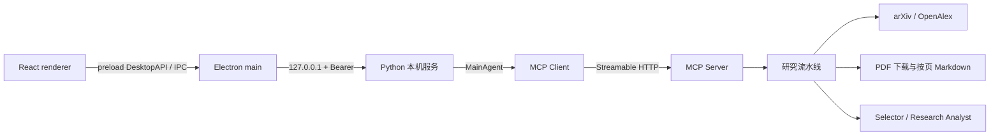

# 架构与接口

当前接口版本 **API v3**，应用版本 **v0.2.2**。公共业务结构见[开发契约](开发契约.md)、[schema](contracts.schema.json)和仓库 `shared/contracts.ts`。

## 进程与调用路径



renderer 不接触本机 bearer token，不直接请求 Python 服务或导入后端算法。Electron main 在启动时通过 service-control 子进程接收 endpoint JSON，并持有 bearer token；preload 只暴露经校验的 `DesktopAPI`。

研究使用现有 MainAgent 经官方 MCP Client 连接 MCP Server；Electron 服务任务使用 Streamable HTTP `/mcp`，stdio CLI 入口继续保留。MCP Server 仍提供 `search_papers`、`select_top_k_papers`、`prepare_fulltexts`、`summarize_selected_papers`、`generate_research_report`、`run_research_pipeline` 六个工具。live 模式的模型工具调用与 demo 的 scripted controller 必须分别标记；demo 的合成论文、响应和产物不算真实研究证据。

## 本机服务发现与安全

服务只绑定 `127.0.0.1`，使用系统分配的端口。同一 data root 由 OS 文件锁保护，服务 endpoint 位于 `service/endpoint.json`，包含本地 URL、MCP URL、PID、API 版本、data root 和随机 bearer token。文件和 token 仅供本机服务及 Electron main 使用，不放入 renderer、普通 CLI 输出或日志。

Electron main 向服务发送 Bearer 鉴权；缺失/错误凭据请求失败，带任意浏览器 `Origin` 的请求被拒绝。服务控制端严格核对 endpoint 的 PID、版本、loopback 地址和规范化 data root；不会接受外网地址或以杀进程方式替换旧服务。检测到旧 API 时，先提示用户等待/取消活动任务，再通过兼容的 service-control 命令正常停止旧服务。

`GET /api/service` 返回非敏感 `ServiceInfo`：

```json
{
  "version": "0.2.2",
  "api_version": 3,
  "pid": 1234,
  "active_jobs": 0,
  "data_root": "<本机资料目录>",
  "config_path": "<本机资料目录>/config.json"
}
```

服务信息不含 token 或 key。配置读取接口只返回 `api_key_configured` 和 `openalex_api_key_configured` 两个布尔状态，不返回密钥正文。

源码 Electron main 运行 `python -m paper_agent.service_control start --json`；冻结版通过同目录 `PaperAgent-service(.exe) --service-control start --json` 启动。该专用 stdout 通道只返回一行 endpoint JSON：`url`、`mcp_url`、`pid`、`api_version`、`data_root`、`token`。仅 Electron main 解析并保留 token，不转发到 renderer 或日志。普通 CLI 输出不包含 token；`status --json` 只包含非敏感服务状态。

## Electron 使用的 REST 接口

所有请求都由 Electron main 添加 Bearer 头；renderer 只调用 preload API。

| HTTP 路由 | 作用与返回 |
|---|---|
| `GET /api/service` | 服务版本、PID、活动任务数、data root 与配置路径。 |
| `POST /api/service/shutdown` | service-control 停止服务的内部接口；活动任务存在时返回 409，不强制取消。 |
| `GET /api/config` | 非密钥设置及两种密钥的已配置状态。 |
| `PUT /api/config` | 保存模型、OpenAlex、代理、Top-k、并发和超时设置；空 key 字段保留已存值，显式 clear 才清除。 |
| `GET /api/conversations` | 会话摘要；历史兼容记录可带 `read_only: true`。 |
| `GET /api/conversations/{conversation_id}` | 消息、关联研究结果及状态。 |
| `POST /api/conversations/messages` | 提交研究或讨论，返回 Job。 |
| `GET /api/jobs/{job_id}` | 当前任务、结果、事件和 artifact 摘要。 |
| `POST /api/jobs/{job_id}/cancel` | 显式取消指定活动任务并保留已有产物。 |
| `GET /api/jobs/{job_id}/events?after={seq}` | 按序号续读真实事件的 SSE；终态后发 `done`。 |
| `GET /api/jobs/{job_id}/artifacts/{artifact_id}/text` | 读取已登记的 Markdown/JSON 文本，最多 2 MiB UTF-8；超限内容会截断并返回 `truncated: true`；PDF 返回 415。 |
| `GET /api/jobs/{job_id}/artifacts/{artifact_id}/location` | 返回已登记文件的本地 path、name、kind，供 Electron 打开/导出。 |

`EventItem` 使用 `seq`、`timestamp`、`kind`、`message`、`stage`、`data`。SSE 的 `event: update` 携带真实 `EventItem`；客户端通过 `after` 续读。终态事件只在后端收到真实 trace 后公开。断开 SSE 或 renderer HMR 不会取消任务；只有用户显式调用 cancel 才取消。服务停止时若有活动任务则拒绝停服，并且关闭窗口不能替代取消任务。

Artifact 路由只接受 job 中实际登记的 `artifact_id`。服务从 job 内部 artifact path/root 信息解析并检查规范化路径、文件存在与后缀；不接收任意本机路径参数。text 只读 `.md` 和 `.json`，location 允许 `.pdf`、`.md`、`.json`。renderer 不能以文件名或路径绕过这层检查。

## 历史、配置与兼容

默认 data root 为 `%LOCALAPPDATA%\Assignment\PaperAgent`，配置文件沿用 `<data_root>\config.json`，会话、job、artifact 和研究结果继续留在原服务目录。`PAPER_AGENT_DESKTOP_DATA_DIR` 可指定另一目录；启动应用与服务控制时应使用同一个值。

旧版 session/job 若没有 `conversation_id`，服务以稳定派生的 32 位 ID 生成只读虚拟 conversation，继续显示原 idea、结果和状态，不回写或重排旧文件。该记录返回 `read_only: true`；尝试在旧记录上继续发消息会收到明确冲突提示，用户可新建会话继续工作。

桌面保存的 DeepSeek/OpenAlex key 仅写入用户 data root 的 `config.json`。有保存字段时它优先于环境；缺少字段时回退进程环境。环境变量优先于 `.env`；非空 `LLM_*` 优先于相应 `DEEPSEEK_*`，OpenAlex 使用 `OPENALEX_API_KEY`。详情见[运行与验收](运行与验收.md)。
